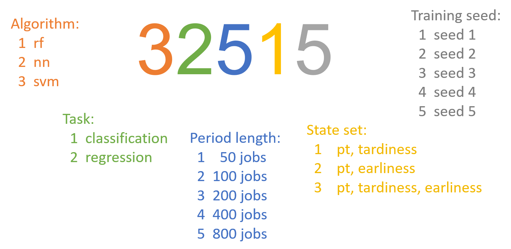

# Dispatching rule selection systems for dynamic jobs shops

### Scope of the repository
The purpose of this github repository is to enable anyone to test their dispatching rule selection systems in a dynamic job shop simulator.

In this page, the focus goes towards the practical side, more precisely, setting the code, running the models, and processing the results.
If one desires more in-depth information, it can be found in the [working paper](drss%20for%20job%20shops%20w292024.pdf) or in the [presentation](euro2024%20presentation.pdf).

### Table of Contents

- [Dispatching rule selection system](#dispatching-rule-selection-system)
- [Dynamic job shop instances](#dynamic-job-shop-instances)
- [Configuring the simulator](#configuring-the-simulator)
    - [Specific guidelines for periodic rule selection models](#specific-guidelines-for-periodic-rule-selection-models)
    - [Specific guidelines for real time rule selection models](#specific-guidelines-for-real-time-rule-selection-models)
	- [Download and execution procedure](#download-and-execution-procedure)
- [Computing model performance](#computing-model-performance)
    - [Reference values - validation](#reference-values---validation)
    - [Reference values - test](#reference-values---test)
- [Benchmark](#benchmark)

### Dispatching rule selection system
In many real-world applications, such as manufacturing settings, uncertain events occur all the time, thus reactive methods are necessary.

In dynamic scheduling, dispatching rules (DRs) such as SPT and FIFO become quite popular as they make scheduling decisions quickly.

However, each dispacthing rule has preferential operating conditions, some are suitable when the job shop is loaded, others perform better when the job shop is emptier.

Therefore, dispatching rule selection systems (DRSSs) emerged in the literature. Their goal is to select DRs over time as conditions change. Two main types of systems emerged in the literature:

| DRSS type  | Description  |
| :----------------: |:-----------------:|
| PRS - Periodic Rule Selection    | Select a DR at fixed periods of time &Delta;t; Tackled with Supervised Learning |
| RTRS - Real time rule selection      | Select a DR every time a machine becomes idle; Tackled with Reinforcement Learning       |

### Dynamic job shop instances
The dynamic job shop is a scheduling problem in which jobs arrive randomly over time to be processed in a pool of machines. Each job has a set of operations that must be processed in a given sequence, and each operation must be processed by a particular machine. In our work the goal is to optimize tardiness, i.e., the time jobs take beyond their due date.

The main parameters are the following:

|   | Parameter  | Validation | Test |
| :-------------: |:--------------:|:------------:|:---------------:|
| *M*    | Number of Machines | 20 | 20 |
| *J* | Number of Jobs1 | 2500 | 2500 |
| *Oj* | Number of operations per job | U(2,14) | U(2,14) |
| *pjo* | Processing times of operations | U(1,*ptMax*): *ptMax*={50,100} | U(1,*ptMax*): *ptMax*={50,100,200} |
| *u* | Utilisation level2 | 0.83, 0.87, 0.93, 0.96 | 0.80, 0.85, 0.90, 0.95, 0.97 |
| *a* | Allowance factor2 | 2.5, 3.5, 5, 7 | 2, 3, 4, 6, 8 |
| nRep | Number of replications for each *u*, *a*, *ptMax* combination | 100 | 100|

1 Each episode ends when 2500 jobs are processed. However, the first 500 jobs belong to the warm-up phase and thus are exluded from tardiness computation.

2 The *utilisation level* and the *allowance factor* have a huge impact in job shop load conditions. The former defines the rate at which jobs arrive. The latter defines the amount of time available to process operations.

### Configuring the simulator
The simulator allows to test both PRS and RTRS models.

Models should rely in one of the three state sets as their input:
- SS_1: Processing times of pending operations & tardiness of pending jobs;
- SS_2: Processing times of pending operations & earliness of pending jobs;
- SS_3: Processing times of pending operations & tardiness of pending jobs & earliness of pending jobs.

The natural logarithm transformation is applied to all variables.

As output, models should suggest one of the three dispatching rules that belong to the action set:  RR, H2, or S9. Internally, these rules are identified by the codes 18, 214, and 508, respectively.

##### Specific guidelines for periodic rule selection models
For PRS, the simulator can run Random Forests (RFs), Neural Networks (NNs) and Support Vector Machines (SVMs) for both classification and regression tasks.

The RFs and SVMs were trained using the *scikit* package for Python and exported as a *.pmml* file to be used in Java.
The neural netoworks were trained using the *keras* package for Python and the weights were exported in a plain .txt file to be used in Java.

Models should be named as follows:
- RF-Class.: *sl&#95;models&#95;m[model&#95;id].pmml*
- RF-Reg.: *sl&#95;models&#95;m[model&#95;id]&#95;[dr_id].pmml*
- NN-Class.: *nn&#95;param&#95;[model&#95;id].txt*
- NN-Reg.: *nn&#95;param&#95;[model&#95;id].txt*
- SVM-Class.: *svm&#95;[model_id].pmml*
- SVM-Reg.: *svm&#95;[model&#95;id]&#95;[dr&#95;id].pmml*

The *model_id* wildcard stands for a 5 digit standardised numeric system that allows to identify diferent models. 

Only the first, second and four digits impact code execution, the others exist for informative reasons.

In regression, it is necessary a model for each DR of the action set, the *dr&#95;id* wildcard identifies the rule.

##### Specific guidelines for real time rule selection models
For RTRS, the code is ready to test QL and DQL models, encoded as look-up tables and neural networks, respectively.

The RTRS models were trained by interacting with the job shop simulator. After training, they were exported as plain .txt files.

Models should be named as follows:
- QL: *q&#95;table&#95;[model&#95;id].txt*;
- DQL:  *nn&#95;param&#95;[model&#95;id].txt*.

The* model&#95;id* wildcard as no particular meaning.

##### Download and execution procedure
1. Download the Java source codes files: [drss-prs](drss-prs.zip), [drss-rtrs](drss-rtrs.zip);
2. Include your own models, by copying them to the main folder, the added files should follow the previous guidelines, by default the code is set up to run a few example models that are included in the source code ;
3. Define the models you want to test, by listing them in the variable nnToTest=[ 32515,... ] of the evaluateRuleRL procedure in the RunSimulator.java class. In RTRS, you should also specify the type of each model in th evariable ssList, e.g., ssList=[ "ql-ss-1", "dql-ss-3",... ];
4. Compile and run the files by adapting the following instructions to your machine:

        ------------------------ LINUX -----------------------
        cd drss_prs/src
        javac -d . -cp .:/homes/user/drss_prs/lib/* *.java
        java -Xms756m -Xmx756m -cp .:/homes/user/drss_prs/lib/* App -benchmarkMode 1 -instanceToTest 6 -episodes 100 -windowLimit 9999 -windowInterval 50 -testMode validation
		
		--------------------- WINDOWS ---------------------
		cd C:\Users\USER_NAME\Downloads\drss_prs\src
		javac -d . -cp ".;C:\Users\USER_NAME\Downloads\drss-prs\lib\*" *.java
		java -cp ".;C:\Users\USER_NAME\Downloads\drss-prs\lib\*" App -file "C:\Users\USER_NAME\Downloads\drss-prs\params\parameters.params" -instanceToTest 6 -windowInterval 50 -testMode validation -episodes 100 -windowLimit 9999 -benchmarkMode 1

The user can configure the run by altering the *java* instruction:
- *testMode*, defines the instances and seeds that are going to be used, there are two possible values: *validation* and *test*;
- *windowInterval*, defines the frequency at which the DR is selected, important for PRS, leave it unchanged in RTRS, the following values are admissable: 50, 100, 200, 400, 800;
- *instanceToTest*, defines the *ptMax* parameter: 6 → *ptMax*=50; 7 → *ptMax*=100; 8 → *ptMax*=200;

These command codes work for both PRS and RTRS models.

### Computing model performance
The software will output a file for each *ptMax*, e.g. *detailedPerformance 200 50 validation i6.txt*, where i6 stands for *ptMax*=50, i7 for *ptMax*=100, and i8 for *ptMax*=200.
In PRS, results are divided into diferent files acording to training period length, e.g. 200, and decision frequency, e.g. 50.

These files must be processed in the following manner to compute the tardiness score of each model:
1. Compute the average performance of each model for each *ptMax*, *u* and *a* combination;
2. Normalise the values computed in the previous step by the respective reference (see tables that follow);
3. Compute the geometric mean using the normalised values.

##### Reference values - validation

| u | a  | ptMax |  Reference | | u | a | ptMax | Reference |
| :-------------: |:--------------:|:------------:|---------------:|------------:|:---------------:|:---------------:|:---------------:|---------------:|
| 0.83 |2.5 |50 |331823 | | 0.83 |2.5 |100 |590031 |
| 0.83 |3.5 |50 |108854 | | 0.83 |3.5 |100 |176085 |
| 0.83 |5.0 |50 |10837 | | 0.83 |5.0 |100 |13666 |
| 0.83 |7.0 |50 |302 | | 0.83 |7.0 |100 |343 |
| 0.87 |2.5 |50 |578357 | | 0.87 |2.5 |100 |1020988 |
| 0.87 |3.5 |50 |293228 | | 0.87 |3.5 |100 |478362 |
| 0.87 |5.0 |50 |60361 | | 0.87 |5.0 |100 |80757 |
| 0.87 |7.0 |50 |3991 | | 0.87 |7.0 |100 |4297 |
| 0.93 |2.5 |50 |1208267 | | 0.93 |2.5 |100 |2126587 |
| 0.93 |3.5 |50 |870462 | | 0.93 |3.5 |100 |1456940 |
| 0.93 |5.0 |50 |416861 | | 0.93 |5.0 |100 |624458 |
| 0.93 |7.0 |50 |95647 | | 0.93 |7.0 |100 |116017 |
| 0.96 |2.5 |50 |1680673 | | 0.96 |2.5 |100 |2944442 |
| 0.96 |3.5 |50 |1329707 | | 0.96 |3.5 |100 |2248914 |
| 0.96 |5.0 |50 |783862 | | 0.96 |5.0 |100 |1238100 |
| 0.96 |7.0 |50 |276994 | | 0.96 |7.0 |100 |370385 |

##### Reference values - test

| u | a  | ptMax |  Reference | | u | a | ptMax | Reference | | u | a | ptMax | Reference |
| :-------------: |:--------------:|:------------:|---------------:|------------:|:---------------:|:---------------:|:---------------:|---------------:|---------------:|:---------------:|:---------------:|:---------------:|---------------:|
| 0.80 |2 |50 |369241 | | 0.80 |2 |100 |681827| | 0.80 |2 |200 |1318873 |
| 0.80 |3 |50 |119671 | | 0.80 |3 |100 |201698| | 0.80 |3 |200 |369831 |
| 0.80 |4 |50 |21719 | | 0.80 |4 |100 |33211| | 0.80 |4 |200 |56527 |
| 0.80 |6 |50 |98 | | 0.80 |6 |100 |138| | 0.80 |6 |200 |172 |
| 0.80 |8 |50 |7 | | 0.80 |8 |100 |16| | 0.80 |8 |200 |48 |
| 0.85 |2 |50 |621761 | | 0.85 |2 |100 |1130057| | 0.85 |2 |200 |2163763 |
| 0.85 |3 |50 |322463 | | 0.85 |3 |100 |547952| | 0.85 |3 |200 |1004930 |
| 0.85 |4 |50 |116701 | | 0.85 |4 |100 |176537| | 0.85 |4 |200 |306929 |
| 0.85 |6 |50 |5697 | | 0.85 |6 |100 |6172| | 0.85 |6 |200 |8488 |
| 0.85 |8 |50 |50 | | 0.85 |8 |100 |34| | 0.85 |8 |200 |54 |
| 0.90 |2 |50 |1046847 | | 0.90 |2 |100 |1889954| | 0.90 |2 |200 |3594317 |
| 0.90 |3 |50 |725368 | | 0.90 |3 |100 |1241692| | 0.90 |3 |200 |2296481 |
| 0.90 |4 |50 |428998 | | 0.90 |4 |100 |678579| | 0.90 |4 |200 |1199313 |
| 0.90 |6 |50 |80044 | | 0.90 |6 |100 |98732| | 0.90 |6 |200 |155712 |
| 0.90 |8 |50 |7247 | | 0.90 |8 |100 |6589| | 0.90 |8 |200 |7401 |
| 0.95 |2 |50 |1749588 | | 0.95 |2 |100 |3113202| | 0.95 |2 |200 |5858747 |
| 0.95 |3 |50 |1407777 | | 0.95 |3 |100 |2416214| | 0.95 |3 |200 |4470124 |
| 0.95 |4 |50 |1064130 | | 0.95 |4 |100 |1749864| | 0.95 |4 |200 |3152303 |
| 0.95 |6 |50 |428072 | | 0.95 |6 |100 |615217| | 0.95 |6 |200 |1031406 |
| 0.95 |8 |50 |122761 | | 0.95 |8 |100 |146724| | 0.95 |8 |200 |217069 |
| 0.97 |2 |50 |2154590 | | 0.97 |2 |100 |3785902| | 0.97 |2 |200 |7074386 |
| 0.97 |3 |50 |1782232 | | 0.97 |3 |100 |3086554| | 0.97 |3 |200 |5707281 |
| 0.97 |4 |50 |1416460 | | 0.97 |4 |100 |2360131| | 0.97 |4 |200 |4291922 |
| 0.97 |6 |50 |671327 | | 0.97 |6 |100 |1020995| | 0.97 |6 |200 |1748243 |
| 0.97 |8 |50 |252311 | | 0.97 |8 |100 |322718| | 0.97 |8 |200 |506110 |

### Benchmark
After running the models and processing the outputed files, it is possible to compare their performance with existing rules and our own DRSS:

| Algorithm | Validation Score | Test Score |
| :-------------: |--------------:|------------:|
| RR | 1.146 | 1.219 |
| H2 | 1.624 | 1.509 |
| S9 | 1.102 | 1.213 |
| RF-Class. | 0.995 | 1.060 |
| RF-Reg. | 0.998 | 1.000 |
| NN-Class. | 0.989 | 0.997 |
| NN-Reg. | 1.023 | 1.039 |
| SVM-Class. | 0.994 | 0.997 |
| SVM-Reg. | 0.992 | 0.995 |
| QL | 1.007 | 1.060 |
| DQL | 0.981 | 1.034 |
